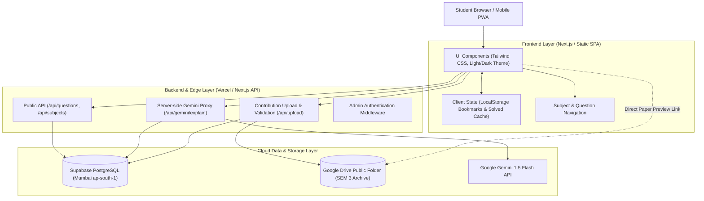

# MGIT PYQ Hub — Technical Architecture

## 1. Architectural Highlights
- **Jamstack & Edge Deployment:** Hosted on Vercel with serverless functions for API endpoints.
- **Database:** Supabase PostgreSQL located in Mumbai (`ap-south-1`) with Row Level Security (RLS) policies.
- **Static Asset Separation:** Heavy binary PDFs remain permanently in Google Drive. The application stores only metadata, extracted question text, and Drive File IDs.
- **Zero-Secret Client:** Client bundles contain only `NEXT_PUBLIC_` anonymous keys. Privileged operations (Service Role, Gemini Key, Admin Key) execute exclusively in Node.js serverless runtimes.
- **Progressive Web App (PWA):** Service worker caching for fast local access and offline revision of bookmarked questions.
