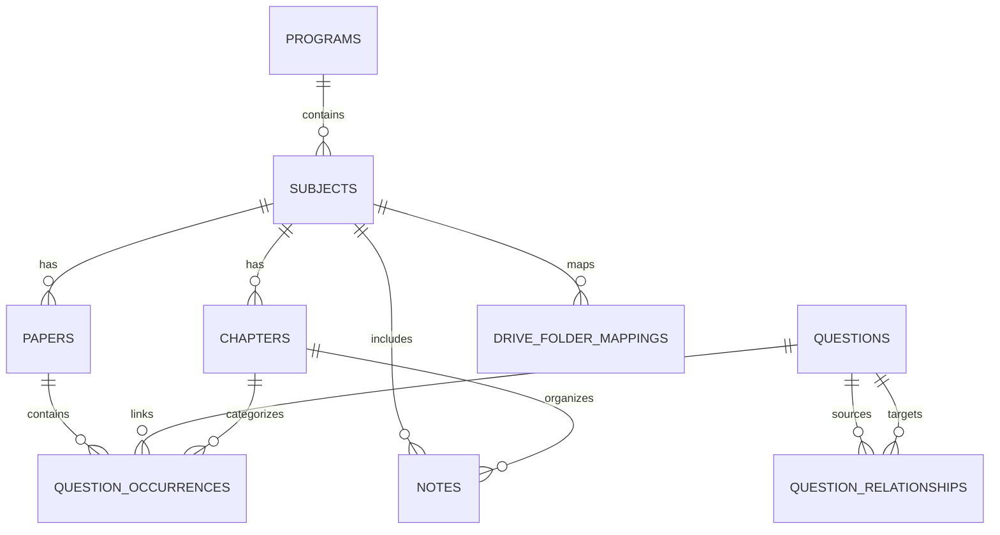

# MGIT PYQ Hub — Database Schema Specification

## 1. Schema Overview
The database uses PostgreSQL on Supabase (`nnqhtpuylejrahgfklzw`, South Asia Mumbai). All primary keys are `UUID` generated via `gen_random_uuid()`. Timestamps are stored in UTC with timezone (`timestamptz`).

---

## 2. Table Definitions

### 2.1 `programs`
Represents the degree and regulation.
- `id` (UUID, PK)
- `code` (VARCHAR, UNIQUE) — e.g. `'MGIT-BTECH-CSE'`
- `title` (VARCHAR) — `'B.Tech Computer Science and Engineering'`
- `institution` (VARCHAR) — `'Mahatma Gandhi Institute of Technology'`
- `regulation` (VARCHAR) — `'R22 / Autonomous'`
- `created_at` (TIMESTAMPTZ, default `now()`)

### 2.2 `subjects`
Semester III subjects.
- `id` (UUID, PK)
- `program_id` (UUID, FK -> `programs.id`)
- `code` (VARCHAR) — e.g. `'CS301PC'`, `'CS302PC'`
- `short_name` (VARCHAR) — `'COA'`, `'DM'`, `'DBMS'`, `'OOP'`, `'SE'`, `'ES'`, `'IE'`
- `title` (VARCHAR) — `'Computer Organization and Architecture'`
- `semester` (INT) — `3`
- `color_hex` (VARCHAR) — `#3b82f6`
- `drive_folder_id` (VARCHAR) — Google Drive Folder ID
- `total_papers_count` (INT, default 0)
- `created_at` (TIMESTAMPTZ, default `now()`)

### 2.3 `chapters`
Units/Chapters for each subject.
- `id` (UUID, PK)
- `subject_id` (UUID, FK -> `subjects.id`)
- `unit_number` (INT) — `1` to `5`
- `title` (VARCHAR) — Unit title
- `course_outcome` (VARCHAR) — e.g. `'CO1'`, `'CO2'`
- `topics_summary` (TEXT)
- `created_at` (TIMESTAMPTZ, default `now()`)

### 2.4 `papers`
Individual exam papers from Google Drive.
- `id` (UUID, PK)
- `subject_id` (UUID, FK -> `subjects.id`)
- `drive_file_id` (VARCHAR, UNIQUE) — Google Drive File ID
- `file_name` (VARCHAR) — e.g. `'Jan 2024 reg.pdf'`
- `drive_web_view_link` (VARCHAR)
- `exam_year` (INT) — e.g. `2024`
- `exam_month` (VARCHAR) — `'Jan'`
- `exam_type` (VARCHAR) — `'Regular'`, `'Supplementary'`, `'Mid-1'`, `'Mid-2'`
- `max_marks` (INT) — `70`
- `is_approved` (BOOLEAN, default `false`)
- `ocr_status` (VARCHAR) — `'pending'`, `'processed'`, `'verified'`
- `created_at` (TIMESTAMPTZ, default `now()`)

### 2.5 `questions` (Canonical Questions)
Deduplicated master concepts.
- `id` (UUID, PK)
- `subject_id` (UUID, FK -> `subjects.id`)
- `canonical_text` (TEXT) — Cleaned canonical question
- `primary_chapter_id` (UUID, FK -> `chapters.id`, nullable)
- `total_occurrences_count` (INT, default 1)
- `importance_tier` (VARCHAR) — `'Tier 1 - Top Priority'`, `'Tier 2'`, `'Tier 3'`
- `created_at` (TIMESTAMPTZ, default `now()`)

### 2.6 `question_occurrences`
Exact question appearances in specific papers.
- `id` (UUID, PK)
- `question_id` (UUID, FK -> `questions.id`)
- `paper_id` (UUID, FK -> `papers.id`)
- `chapter_id` (UUID, FK -> `chapters.id`, nullable)
- `question_number_printed` (VARCHAR) — e.g. `'Q1(a)'`, `'Q3'`
- `section_part` (VARCHAR) — `'Part A'`, `'Part B'`
- `marks_printed` (INT) — e.g. `2`, `10`
- `page_number_in_pdf` (INT) — e.g. `1`
- `raw_extracted_text` (TEXT)
- `solution_guide` (TEXT)
- `examiner_tips` (TEXT)
- `created_at` (TIMESTAMPTZ, default `now()`)

### 2.7 `question_relationships`
Repetition graph.
- `id` (UUID, PK)
- `source_question_id` (UUID, FK -> `questions.id`)
- `target_question_id` (UUID, FK -> `questions.id`)
- `relationship_type` (VARCHAR) — `'exact_repeat'`, `'near_variant'`, `'conceptual_overlap'`
- `similarity_score` (DECIMAL) — `0.00` to `1.00`
- `notes` (TEXT)
- `created_at` (TIMESTAMPTZ, default `now()`)

### 2.8 `notes`
Approved student & faculty notes.
- `id` (UUID, PK)
- `subject_id` (UUID, FK -> `subjects.id`)
- `chapter_id` (UUID, FK -> `chapters.id`, nullable)
- `title` (VARCHAR) — e.g. `'Unit 1 Complete Study Notes'`
- `drive_file_id` (VARCHAR)
- `drive_link` (VARCHAR)
- `file_size_bytes` (BIGINT)
- `is_approved` (BOOLEAN, default `false`)
- `created_at` (TIMESTAMPTZ, default `now()`)

### 2.9 `contributions`
Student upload submission queue.
- `id` (UUID, PK)
- `subject_id` (UUID, FK -> `subjects.id`)
- `resource_kind` (VARCHAR) — `'pyq'` or `'notes'`
- `chapter_number` (INT, nullable)
- `contributor_name` (VARCHAR, default `'Anonymous Student'`)
- `temp_file_url` (VARCHAR)
- `status` (VARCHAR) — `'pending'`, `'approved'`, `'rejected'`
- `rejection_reason` (TEXT, nullable)
- `created_at` (TIMESTAMPTZ, default `now()`)

### 2.10 `drive_folder_mappings`
Admin-managed Google Drive folder registry.
- `id` (UUID, PK)
- `subject_id` (UUID, FK -> `subjects.id`)
- `resource_kind` (VARCHAR) — `'pyqs_root'`, `'notes_root'`, `'chapter_notes'`
- `chapter_number` (INT, nullable)
- `drive_folder_id` (VARCHAR) — e.g. `'1axgSIkJ5-WfD_xZpna8KFKnNxcaZ0AyX'`
- `is_public` (BOOLEAN, default `true`)
- `last_verified_at` (TIMESTAMPTZ)

---

## 3. Row Level Security (RLS) Policy Blueprint
- **Public Read (`SELECT`):** Open to `anon` and `authenticated` roles for records where `is_approved = true` on `papers`, `questions`, `question_occurrences`, and `notes`.
- **Public Insert (`INSERT`):** Permitted only on `contributions` with rate-limiting and validation triggers.
- **Admin Full Control (`ALL`):** Restricted to `authenticated` users possessing admin claims or passing server-side `SUPABASE_SERVICE_ROLE_KEY`.
