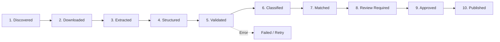

# MGIT PYQ Hub — Data Ingestion Pipeline

## 1. Pipeline Overview
Because past MGIT question papers are scanned image PDFs, extraction cannot rely on simple text streams. The ingestion pipeline runs as a resilient, idempotent server-side process using Google Gemini 1.5 Flash Document Processing capabilities.

---

## 2. Eleven Lifecycle Stages

1. **`discovered`**: New PDF detected in the subject Google Drive folder via change polling or initial inventory.
2. **`downloaded`**: PDF stream retrieved into a temporary sandboxed buffer with checksum hashing (SHA-256).
3. **`extracted`**: Visual page images processed through OCR and vision analysis.
4. **`structured`**: Metadata extracted:
   - Paper header (Year, Exam Type, Month, Max Marks).
   - Questions (Q.No, Sub-parts, Printed Marks).
   - Printed CO / Chapter column values.
5. **`validated`**: Schema validation checks:
   - Total marks sum equals 70 (or 20 for Part A, 50 for Part B).
   - Question numbers follow sequential pattern.
   - Printed CO maps to valid Unit (1–5).
6. **`classified`**: Categorization into Part A (Short, 2–4 Marks) vs Part B (Essay/Problems, 10 Marks).
7. **`matched`**: Algorithmic comparison with existing canonical questions:
   - *Exact Repeat* (Levenshtein distance $\le 5$ after token normalization).
   - *Near-Variant* (Same problem structure with altered numerical parameters).
   - *Conceptual Overlap* (Cosine similarity $> 0.85$ on embeddings).
8. **`review_required`**: Papers with blurred text, low OCR confidence, or unmapped CO values flagged for admin review.
9. **`approved`**: Reviewer confirms question text and chapter assignments.
10. **`published`**: Records committed to Supabase tables and made visible to students.
11. **`failed`**: Idempotent error handling with retry counters and detailed failure logs.

---

## 3. Preservation of Diagrams and Formulas
- Formulas are converted to standard LaTeX notation (`$...$` and `$$...$$`).
- Diagrams (circuits, K-maps, graphs, memory layouts) keep page and coordinate references to the original PDF in Google Drive.
